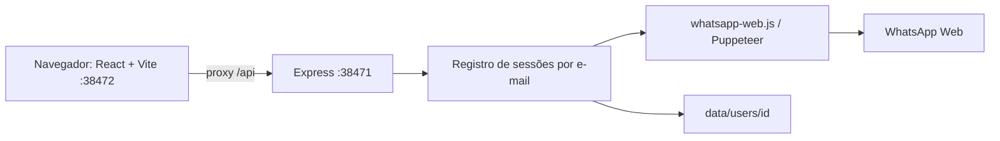
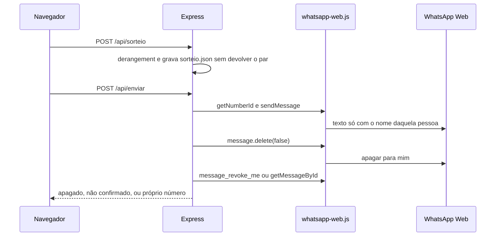

# secret-friend-on-whatsapp

[](https://github.com/Michel1412/secret-friend-on-whatsapp/actions/workflows/ci.yml)

Web app to run a Secret Santa (amigo secreto) over WhatsApp: connects a number by QR, draws pairs with no self-matches, sends each person their match and deletes it for the sender, keeping the draw secret even from the organizer.

Aplicativo web de amigo secreto pelo WhatsApp: conecta um número pelo QR, sorteia pares sem ninguém tirar a si mesmo, manda para cada pessoa só o nome que ela tirou e apaga essa mensagem para quem enviou, para o sorteio continuar secreto até para quem organiza.

A marca na tela é **Papelzinho**, ao lado de um presente azul com laço (`src/components/GiftLogo.tsx`, o mesmo desenho do `public/favicon.svg`). O tema é festa sobre fundo neutro: papel quente, texto escuro e acentos de confete (azul, verde, âmbar, coral e violeta), sem fundo colorido. As cores ficam só em `src/index.css`. No WhatsApp, em Aparelhos conectados, o app tenta mostrar o aparelho como **Papelzinho - ZAP** (Chrome). Se essa versão do WhatsApp Web não entregar o módulo do navegador, o pareamento segue e o celular mostra o nome padrão.

## Visão geral e funcionalidades

O organizador entra com um e-mail, pareia um WhatsApp, cadastra a turma, sorteia e dispara o envio. A tela de andamento mostra se a mensagem saiu e se foi apagada para quem enviou. Ela não mostra quem tirou quem.

- **Login por e-mail, sem validação.** Não há senha nem confirmação de caixa de entrada. O e-mail é aparado, posto em minúsculas e aceito se tiver o formato `algo@algo` (3 a 200 caracteres, sem espaço). Ele só separa os dados neste navegador. O cookie `secret-friend-on-whatsapp-email` é `HttpOnly`, `SameSite=Lax` e dura um ano.
- **Conexão por QR.** O botão **Gerar QR** chama `POST /api/whatsapp/connect`. O polling da tela (`GET /api/whatsapp`, `GET /api/sorteio` e `GET /api/historico`) só lê o estado: não abre o navegador. O intervalo é 1,6 s, e 0,8 s enquanto um envio está ativo. Se uma abertura já está em andamento, outro clique espera a mesma tentativa.
- **Selo Verificado.** Fica verde (esmeralda, sobre fundo claro) quando o cliente está `ready` e `getChats()` terminou. Enviar e **Testar apagar** ficam bloqueados até esse selo. Deixe o WhatsApp aberto no celular até o selo aparecer.
- **Cadastro.** Nome (até 80 caracteres) e celular brasileiro com DDD. Número fixo não entra. Tudo fica no perfil daquele e-mail. O formulário só libera com o WhatsApp conectado, e trava de novo enquanto um sorteio ou um envio está em andamento. Até 200 pessoas. **Exportar lista** baixa `participantes.json` (lista, texto e intervalo; sem pares).
- **Importação.** CSV, texto ou TSV (vírgula, ponto e vírgula ou tabulação; UTF-8 com ou sem BOM), Excel `.xlsx` (dá para escolher a aba), JSON no formato da exportação, ou um trecho colado da planilha. O arquivo pode ter até 5 MB. A prévia deixa escolher qual coluna é o nome e qual é o telefone. O app sugere pelo cabeçalho (`nome`, `name`, `participante`, `telefone`, `celular`, `whatsapp`, `phone`, `zap` e afins). Dá para marcar se a primeira linha é cabeçalho, substituir a lista ou acrescentar. Um JSON também pode trazer a mensagem e o intervalo. Telefone inválido, vazio ou repetido aparece na prévia e não entra.
- **Mensagem.** O padrão é `Oi! No amigo secreto você tirou: {{sorteado}}. Guarda segredo 🤫`. `{{amigo}}` também vira o nome sorteado. Sem uma das duas marcas, o envio nem começa. O texto guarda no máximo 1000 caracteres. A pausa da tela é 2, 3, 4, 6 ou 8 segundos (padrão 3).
- **Sorteio.** Com pelo menos 2 pessoas, ninguém tira a si mesmo e cada pessoa é sorteada uma vez (permutação sem ponto fixo; se o sorteio aleatório não achar uma em 1000 tentativas, cai numa rotação). Com uma pessoa só, não há sorteio. Sortear de novo substitui o resultado e fecha a quebra de sigilo. Se a lista mudar depois do sorteio, a tela pede para sortear de novo antes de enviar; a quebra de sigilo ainda abre o resultado guardado.
- **Envio e apagar para mim.** Cada mensagem sai com `sendMessage`. Depois da pausa (`DELETE_FOR_ME_DELAY_MS`, padrão 1,5 s), `message.delete(false)` pede ao WhatsApp Web para apagar **para mim**, não para todos. Quem recebeu continua com o texto. Há até 3 tentativas, com 600 ms entre uma conferência e outra. **Apagado** só entra se chegar `message_revoke_me` ou se a mensagem sumir ao recarregar. Sem isso fica **Enviado (não confirmado apagado)**. Na tela, apagado é verde esmeralda, enviado sem confirmação é âmbar, o próprio número é violeta e o erro é vermelho (`--erro`). Pendente fica neutro. O coral segue só nos acentos de festa.
- **Continuar envio.** O botão chama de novo `POST /api/enviar`, sem lista de ids. A fila pega quem não está `apagado` e não é o próprio número. Se a pessoa já está `enviado` e há id da mensagem, o app não manda outra cópia: grava o evento `reenviado` e só tenta `delete(false)` de novo. O rótulo fica **Continuar envio** ou **Tentar apagar de novo**, conforme o que ainda falta. O corpo da API aceita `ids` para limitar a fila; a tela não envia esse campo. O tool MCP `resend` envia.
- **O próprio número não é apagado.** Se o participante é o WhatsApp conectado, a mensagem é enviada e permanece. O detalhe fica “Enviado para o próprio número, não apagado.” Na etiqueta, “No seu número”.
- **Testar apagar.** Manda `Teste Papelzinho #` e um código de 8 dígitos. O campo vazio usa o número conectado. O histórico guarda o destino mascarado (só os 4 últimos dígitos) e se o envio e o apagar confirmaram. `testes.json` guarda os últimos 8 testes.
- **Histórico de envio.** `historico.json` acumula eventos (`consulta`, `enviado`, `apagado`, `nao_confirmado`, `proprio_numero`, `erro`, `reenviado`, `teste`) sem o nome sorteado e sem o texto. `GET /api/historico?sorteio=` devolve essa lista; sem o parâmetro, devolve todos os eventos daquele e-mail. A tela pede o id do sorteio atual e mostra uma tabela de eventos (pessoa, tipo, destino mascarado, tentativa e horário no fuso do navegador). O status de cada pessoa sai do último evento daquele sorteio, ignorando `consulta` e `teste`.
- **Quebra de Sigilo.** Abre um modal de proteção. A frase fixa é `quero quebrar o sigilo`. Ela precisa ser digitada: colar, arrastar, o menu do botão direito, `Ctrl/Cmd+V` e `Shift+Insert` estão bloqueados. Copiar e recortar o campo também. Maiúsculas e espaços a mais não importam. Frase errada mantém a lista fechada. Depois de 5 erros seguidos, o modal espera 20 segundos. Só então a API devolve quem tirou quem (nome e telefone), com exportação JSON (`quebra-de-sigilo.json`) e CSV com ponto e vírgula (`quebra-de-sigilo.csv`). Atualizar a página esconde a lista. A frase não é uma senha.

## Dependências

Versões declaradas em `package.json` e travadas em `package-lock.json`. A licença de cada pacote está em [Créditos](#créditos).

### Sistema

- **Node.js 20 ou mais recente.** O campo `engines.node` é `>=20`. Não há `.nvmrc`. O job `ci` instala o Node.js 22.
- **npm** que acompanha esse Node. O arquivo `.npmrc` do repositório liga `legacy-peer-deps=true`; `npm ci` e `npm install` já usam isso.
- **Git**, para clonar o repositório.
- **Google Chrome, Microsoft Edge ou Chromium**, para o Puppeteer abrir o WhatsApp Web em headless. O caminho é o de `CHROME_PATH` ou a busca descrita em [Como rodar](#como-rodar). Se nenhum existir, o Puppeteer usa o Chrome que ele mesmo baixa (dependência do `whatsapp-web.js`, não um pacote direto deste `package.json`; no lock atual, Puppeteer 24.38.0).
- **Um celular com WhatsApp**, para ler o QR.

### Backend

- **express** — API HTTP.
- **cors** — o navegador da interface chama a API com cookie.
- **dotenv** — lê o `.env` da raiz na API e no `npm run mcp`.
- **pino** — log. O padrão é `warn`.
- **qrcode** — transforma o QR do WhatsApp Web em imagem para a tela.

### Frontend

- **react** e **react-dom** — a interface.
- **@radix-ui/react-dialog** — modal de importação e da quebra de sigilo.
- **@radix-ui/react-slot** — o botão pode se comportar como outro elemento.
- **class-variance-authority**, **clsx** e **tailwind-merge** — variantes e classes do botão.
- **lucide-react** — ícones.
- **@fontsource/fraunces** e **@fontsource/outfit** — fontes do título e do texto, servidas pelo próprio app.
- **xlsx** (SheetJS) — lê `.xlsx` na importação e monta a planilha do tool `export_list`.

### WhatsApp

- **whatsapp-web.js** (1.34.8) — cliente do WhatsApp Web: QR, `sendMessage` e `message.delete(false)`, com `LocalAuth` no disco.
- **Puppeteer** — vem com o `whatsapp-web.js`. Abre Chrome, Edge ou Chromium em headless (`--no-sandbox`, `--disable-dev-shm-usage`). Não está listado direto no `package.json`.

### MCP

- **@modelcontextprotocol/sdk** — servidor MCP em stdio e, se `MCP_HTTP_PORT` estiver definido, em HTTP só em `127.0.0.1`.
- **zod** — descreve os argumentos dos tools. Não está no `package.json`; entra como dependência do SDK.

### Testes e ferramentas

- **vite** e **@vitejs/plugin-react** — interface em desenvolvimento e build de `dist/`.
- **tailwindcss** e **@tailwindcss/vite** — estilos.
- **typescript** — `npm run typecheck` (interface e servidor).
- **tsx** — roda a API e o MCP em TypeScript; `watch` no `npm run dev`.
- **concurrently** — sobe API e Vite juntos no `npm run dev` e encerra os dois se um cair (`-k`).
- **vitest** e **@vitest/coverage-v8** — testes e cobertura.
- **happy-dom** — DOM dos testes de componente.
- **@testing-library/react**, **@testing-library/user-event** e **@testing-library/dom** — testes da tela. `dom` está em `dependencies`, mas só entra nos testes.
- **supertest** e **@types/supertest** — testes HTTP de `createApp`.
- **@types/node**, **@types/express**, **@types/cors**, **@types/react**, **@types/react-dom**, **@types/qrcode** — tipos.

## Como rodar

Do clone vazio até o QR. O atalho, com Node e um navegador já instalados:

```bash
git clone https://github.com/Michel1412/secret-friend-on-whatsapp.git
cd secret-friend-on-whatsapp
npm ci
cp .env.example .env
npm run dev
```

Abra [http://127.0.0.1:38472](http://127.0.0.1:38472). A API fica em [http://127.0.0.1:38471](http://127.0.0.1:38471).

### Pré-requisitos

| Peça | Versão | Como conferir |
| --- | --- | --- |
| Node.js | 20 ou mais recente. O CI usa 22. Não há `.nvmrc`. | `node -v` |
| npm | O que vem com esse Node. | `npm -v` |
| Git | Qualquer versão atual que clone por HTTPS. | `git --version` |
| Navegador | Google Chrome, Microsoft Edge ou Chromium já instalados. Sem versão mínima no código. | Veja a busca abaixo |
| Celular | WhatsApp instalado, de preferência um chip secundário. | — |

O pacote `whatsapp-web.js` aceita Node 18, mas este repositório exige Node 20 (`engines`). Um Node de pacote antigo da distribuição Linux pode ficar abaixo disso: use o Node 20 ou 22 oficial.

**Onde o app procura o navegador.** `CHROME_PATH` no `.env` ganha se o arquivo existir. Se estiver vazio ou apontar para um arquivo que não existe, a ordem é esta (`server/src/chrome-path.ts`):

- **Windows:** Chrome em `%PROGRAMFILES%`, em `%PROGRAMFILES(X86)%` e em `%LOCALAPPDATA%`; depois Edge em `%PROGRAMFILES(X86)%\Microsoft\Edge\Application\msedge.exe` e em `%PROGRAMFILES%\Microsoft\Edge\Application\msedge.exe`.
- **macOS:** `/Applications/Google Chrome.app/Contents/MacOS/Google Chrome` e `/Applications/Microsoft Edge.app/Contents/MacOS/Microsoft Edge`. O Chromium em `/Applications` não entra nessa lista: use `CHROME_PATH`.
- **Linux:** `/usr/bin/google-chrome`, `/usr/bin/google-chrome-stable`, `/usr/bin/chromium` e `/usr/bin/chromium-browser`. Para o Edge do Linux, defina `CHROME_PATH` (em geral `/usr/bin/microsoft-edge` ou `/usr/bin/microsoft-edge-stable`).

O uso no dia a dia é Windows e Linux. O código também abre Chrome ou Edge no macOS pelos caminhos acima.

Se nenhum candidato existir, o Puppeteer abre o Chrome que ele baixou. Com Chrome ou Edge no caminho, esse download não é necessário. O navegador sobe em headless: não aparece uma janela. O QR sai na página do Papelzinho.

**Notas por sistema**

- **Windows.** No prompt, `copy .env.example .env` no lugar de `cp`. Caminhos do Edge levam barra invertida, por exemplo `C:\Program Files (x86)\Microsoft\Edge\Application\msedge.exe`. O perfil do Edge dentro de `data/` é o que faz o Vite quebrar se a pasta for varrida; o repositório já ignora isso (veja [solução de problemas](#debug-e-solução-de-problemas)).
- **Linux.** `cp` e `npm` funcionam no shell. Instale `google-chrome` ou `chromium` pelo gerenciador da distribuição, ou defina `CHROME_PATH`.
- **macOS.** `cp` funciona. Chrome e Edge em `/Applications` são achados sozinhos.

### Clonar

```bash
git clone https://github.com/Michel1412/secret-friend-on-whatsapp.git
cd secret-friend-on-whatsapp
```

### Instalar

`npm ci` instala exatamente o `package-lock.json`. É o que o CI faz, e é o caminho certo num clone novo. `npm install` também funciona e pode reescrever o lock se `package.json` e o lock divergirem.

O `.npmrc` da raiz contém `legacy-peer-deps=true`. Não apague esse arquivo: sem ele, o npm pode recusar a árvore por peer dependencies.

O `npm ci` pode disparar o script de instalação do Puppeteer e baixar um Chrome. Se o disco padrão estiver cheio (no Windows, o `C:`), defina `PUPPETEER_CACHE_DIR` **no terminal, antes** do `npm ci`. O app não lê essa variável; quem lê é o Puppeteer. Exemplo: `E:\puppeteer-cache`.

### Arquivo `.env`

```bash
cp .env.example .env
```

No Windows, sem `cp`:

```bat
copy .env.example .env
```

Sem `.env`, a API e o Vite usam os padrões da tabela (porta 38471, interface 38472, pasta `data`, pausas e `LOG_LEVEL=warn`). O MCP não sobe sem `MCP_EMAIL`. A API (`server/src/config.ts`) e o `npm run mcp` (`loadMcpEnv`) leem o `.env` da raiz. O Vite lê `PORT`, `CLIENT_PORT` e `DATA_DIR` do mesmo arquivo.

Não commite o `.env`. Ele está no `.gitignore`. O único token de exemplo aprovado é `token-dev-mcp-cursor`, e ele fica comentado no `.env.example`.

| Variável | Padrão | O que faz |
| --- | --- | --- |
| `DATA_DIR` | `data` | Pasta das sessões, listas, sorteios, histórico e testes. Caminho relativo é resolvido a partir da raiz do projeto. |
| `PORT` | `38471` | Porta da API. Inteiro de 1 a 65535. A API escuta em `0.0.0.0`; o endereço para abrir é `127.0.0.1`. |
| `CLIENT_PORT` | `38472` | Porta do Vite em `npm run dev` (`strictPort`: se estiver ocupada, o Vite encerra). A API só usa esse valor no log, para dizer onde abrir a interface. O Vite também escuta em `0.0.0.0`. |
| `CHROME_PATH` | vazio | Executável do Chrome, do Edge ou do Chromium. Se o arquivo existir, é ele que o Puppeteer abre. Se estiver vazio ou o arquivo não existir, vale a busca por sistema. Se ninguém for achado, fica o Chrome do Puppeteer. |
| `PUPPETEER_CACHE_DIR` | comentada | Não é lida pelo código deste app. É variável do Puppeteer: defina no terminal **antes** do `npm ci` se for deixar o Puppeteer baixar um Chromium e o disco padrão estiver cheio. |
| `SEND_DELAY_MS` | `3000` | Pausa padrão entre uma pessoa e outra, em milissegundos, quando o pedido não manda um número válido. O servidor limita o valor entre 2000 e 15000. O perfil da tela só grava 2000, 3000, 4000, 6000 ou 8000. |
| `DELETE_FOR_ME_DELAY_MS` | `1500` | Espera depois do envio, antes de `message.delete(false)`. Limitada entre 500 e 10000. |
| `ACK_TIMEOUT_MS` | `6000` | Lida e limitada entre 1000 e 30000 em `config.ts`. O envio atual não consulta esse tempo. Mudar o valor não altera o envio. |
| `DELETE_CONFIRM_TIMEOUT_MS` | `8000` | Lida e limitada entre 1000 e 30000 em `config.ts`. A confirmação do apagar não usa esse tempo: espera 600 ms, olha `message_revoke_me` ou `getMessageById`, e tenta até 3 vezes. |
| `MCP_EMAIL` | comentada | E-mail da sessão que o `npm run mcp` usa. Use o mesmo e-mail da interface, para cair na mesma pasta e no mesmo WhatsApp. Sem ela, `npm run mcp` encerra. |
| `MCP_API_BASE` | `http://127.0.0.1:38471` | URL da API. Se a variável estiver vazia, o código usa esse endereço. A API precisa estar no ar. |
| `MCP_HTTP_PORT` | comentada (`38473`) | Se definida, o mesmo processo do MCP também escuta HTTP só em `127.0.0.1`, no caminho `/mcp`. Não é um padrão do código: sem a variável, só existe o stdio. |
| `MCP_TOKEN` | comentada (`token-dev-mcp-cursor`) | Bearer exigido pelo HTTP. O valor do exemplo serve só para teste local. O Cursor lê o mesmo nome pela interpolação `${env:MCP_TOKEN}`. Sem token, o modo HTTP encerra. |
| `LOG_LEVEL` | `warn` | Nível do Pino: `silent`, `warn`, `info` ou `debug`. `info` mostra jid, id da mensagem, o executável escolhido e o passo do teste de apagar. O texto da mensagem e o nome sorteado não entram no log. |

`config.ts` também lê `WHATSAPP_AUTH_DIR` (padrão `data/auth`) e `DRAW_FILE` (padrão `data/sorteio.json`), mas nenhuma sessão nem sorteio consulta esses campos. A pasta real é `DATA_DIR/users/<id>/`. Definir as duas não move o pareamento.

### Modo de desenvolvimento

```bash
npm run dev
```

Isso roda, juntos:

- `npm run dev:api` — `tsx watch` em `server/src/index.ts`, sem observar `data/`, `coverage/`, `dist/`, `.wwebjs_auth/` nem `.wwebjs_cache/`.
- `npm run dev:web` — Vite em `0.0.0.0`, na `CLIENT_PORT`, com `strictPort`. O `/api` é encaminhado para `http://127.0.0.1:PORT`.

O guia para agentes de código está em [AGENTS.md](AGENTS.md).

Abra [http://127.0.0.1:38472](http://127.0.0.1:38472). Não use a porta da API como página: `npm run dev` não serve a interface por ela. A interface e a API escutam em todas as interfaces (`0.0.0.0`). O MCP HTTP, se você subir, escuta só em `127.0.0.1`.

Pare os dois com Ctrl+C. O `concurrently -k` encerra o que sobrar. A API, ao receber `SIGINT`, `SIGTERM` ou `beforeExit`, chama `client.destroy()` nos Chromes abertos.

### Build de produção

```bash
npm run build
npm start
```

`npm run build` (`vite build`) gera a interface em `dist/`. `npm start` (`tsx server/src/index.ts`) sobe **só a API**, na `PORT`, em `0.0.0.0`. Ele não serve `dist/`.

Para abrir a interface compilada é preciso um servidor estático na frente, com `/api` apontando para `http://127.0.0.1:PORT`. Este repositório não traz esse servidor. `npm run dev` já faz a ponte. No [deploy](#deploy), o volume de `data/` tem de sobreviver ao processo.

### Conectar o WhatsApp pelo QR

1. Abra [http://127.0.0.1:38472](http://127.0.0.1:38472) e entre com um e-mail. Não há senha.
2. Clique em **Gerar QR**. A primeira abertura sobe o navegador headless; pode levar alguns segundos. Se o QR já estiver na tela, o botão passa a **Atualizar QR**.
3. No celular: WhatsApp → **Aparelhos conectados** → **Conectar um aparelho**, e leia o QR.
4. O aparelho aparece como **Papelzinho - ZAP** quando o WhatsApp Web deixa renomear; se não deixar, fica o nome padrão do navegador. Espere o selo **Verificado** (o app do celular precisa ficar aberto até `getChats()` terminar).
5. Cadastre a turma, sorteie e envie. Enviar e **Testar apagar** seguem bloqueados sem o selo.

**Desconectar** chama `POST /api/whatsapp/logout` e despareia (recusa se houver envio em andamento). **Sair** chama `DELETE /api/sessao`: apaga o cookie e fecha o navegador daquela sessão, e **deixa os arquivos** em `data/`.

### Onde ficam as sessões

Tudo fica em `DATA_DIR` (padrão `data/`, na raiz do projeto):

```text
data/users/<32 hex do SHA-256 do e-mail>/
├── perfil.json
├── sorteio.json
├── historico.json
├── testes.json
└── wwebjs/session-<mesmo id>/    perfil do Chrome ou do Edge (LocalAuth)
```

Trate `data/` como uma senha. Ali estão a sessão do WhatsApp e o mapa de quem tirou quem, em texto. Não commite, não sincronize em pasta compartilhada e não mande para outra pessoa. O `.gitignore` deixa de fora `data/`, `.env`, `.wwebjs_auth/` e `.wwebjs_cache/`. Quem tem a pasta lê o sorteio sem o modal.

### Subir o MCP

A API (`npm run dev` ou `npm start`) precisa estar no ar. Noutro terminal, na raiz:

```bash
npm run mcp
```

O processo lê o `.env`. Sem `MCP_EMAIL`, ele encerra. Com `MCP_HTTP_PORT` e `MCP_TOKEN`, o mesmo processo também escuta `http://127.0.0.1:<porta>/mcp` (no exemplo, a porta é 38473) **e** continua no stdio. O HTTP não guarda sessão: cada POST cria um servidor e um transporte novos e responde JSON. O SDK devolve 500 se o mesmo transporte sem id de sessão for reutilizado; qualquer método que não seja POST responde 405. Só aceita conexão de `127.0.0.1` com `Authorization: Bearer <MCP_TOKEN>`.

Exemplo de `mcp.json` em modo stdio, para o Claude Desktop ou para o Cursor iniciar o comando:

```json
{
  "mcpServers": {
    "papelzinho": {
      "command": "npm",
      "args": ["run", "mcp"],
      "env": {
        "MCP_EMAIL": "ada@exemplo.test",
        "MCP_API_BASE": "http://127.0.0.1:38471"
      }
    }
  }
}
```

O passo a passo do Cursor em HTTP está em [Usando o MCP no Cursor](#usando-o-mcp-no-cursor). O tool `break_secrecy` revela os pares e pede a frase `quero quebrar o sigilo`. Os outros tools não devolvem o sorteio.

### Testes, tipos e cobertura

| Comando | O que faz |
| --- | --- |
| `npm test` | Vitest, uma vez. Não abre Chrome. |
| `npm run test:coverage` | O mesmo, com cobertura v8. |
| `npm run typecheck` | `tsc` da interface (`tsconfig.json`) e do servidor (`tsconfig.server.json`). |
| `npm run build` | `vite build` em `dist/`. |
| `npm start` | Só a API. Não serve `dist/`. |
| `npm run mcp` | Servidor MCP. A API já tem de estar no ar. |
| `npm run dev:api` | Só a API, com `tsx watch`. |
| `npm run dev:web` | Só o Vite. |

O piso global da cobertura é 85% de linhas e 73% de ramos. Por pasta: `shared/` 90% de linhas e 78% de ramos, `server/src/` 90% e 73%, `src/` 80% e 68%. `server/src/mcp.ts` fica de fora da medição, assim como os testes, `src/main.tsx` e `src/vite-env.d.ts`. O job `ci` (`.github/workflows/ci.yml`) roda `npm ci`, `npm run test:coverage`, `npm run typecheck` e `npm run build` em pull request para `main` e em push na `main`, no Ubuntu, com Node.js 22.

## Usando o MCP no Cursor

O Cursor na mesma máquina fala com o MCP HTTP em [http://127.0.0.1:38473/mcp](http://127.0.0.1:38473/mcp). O header é `Authorization: Bearer` seguido do token. A sintaxe `${env:NOME}` em `command`, `args`, `env`, `url` e `headers` é a documentada pelo Cursor ([Config interpolation](https://cursor.com/docs/mcp)): o processo do Cursor substitui a variável. No HTTP, `MCP_TOKEN` vem do ambiente que inicia o Cursor. O campo `envFile` do `mcp.json` vale para o modo stdio.

1. Suba o aplicativo com `npm run dev`. A API fica em [http://127.0.0.1:38471](http://127.0.0.1:38471).
2. Defina `MCP_TOKEN` (e `MCP_EMAIL`, `MCP_HTTP_PORT=38473`) no `.env`. O `npm run mcp` lê esse arquivo. No `.env.example` o token de teste é `token-dev-mcp-cursor`. Esse valor serve só para teste local. Troque-o antes de usar de verdade. Use o mesmo token no ambiente do Cursor, para o `${env:MCP_TOKEN}` do header.
3. Noutro terminal, rode `npm run mcp`. Com porta e token, o processo escuta só em `127.0.0.1`.
4. Copie a configuração de [`.cursor/mcp.json`](.cursor/mcp.json) se o Cursor não estiver aberto nesta pasta (por exemplo para `~/.cursor/mcp.json`; no Windows, `%USERPROFILE%\.cursor\mcp.json`). Com o projeto aberto, o Cursor já lê esse arquivo. Ele aponta para `http://127.0.0.1:38473/mcp` e envia `Authorization: Bearer ${env:MCP_TOKEN}`. O arquivo vai no git porque o token fica na variável, fora do JSON.
5. Recarregue a janela do Cursor (paleta de comandos: **Developer: Reload Window**). O servidor `papelzinho` lista estes tools:

| Tool | O que faz |
| --- | --- |
| `get_status` | Lê conexão, selo Verificado e número. Não abre o navegador. |
| `get_qr_code` | Devolve o QR em imagem e data URL. Se não houver QR e o número não estiver conectado, dispara o mesmo fluxo de **Gerar QR**. |
| `test_send_and_delete` | Roda **Testar apagar**. Exige Verificado. `telefone` é opcional. |
| `import_list` | Importa um CSV/XLSX (caminho) ou linhas. Escolhe as colunas de nome e telefone. Não sorteia. |
| `export_list` | Exporta a lista em CSV ou XLSX, sem pares. |
| `draw` | Sorteia a lista salva. Exige WhatsApp conectado. Não devolve os pares. |
| `start_send` | Começa o envio do modelo. Exige Verificado. |
| `resend` | Reenvia quem ainda está pendente, ou só os `ids`. Pula quem já está apagado. Quem já foi enviado e ainda tem id de mensagem só tenta apagar de novo. Exige Verificado. |
| `get_members_status` | Status de cada pessoa agora, sem pares. |
| `get_history` | Histórico append-only. `sorteioId` é opcional. Sem texto e sem nome sorteado. |
| `break_secrecy` | Revela quem tirou quem. Exige a frase `quero quebrar o sigilo`. Tem `destructiveHint` e a mesma trava da tela (5 erros, depois 20 segundos). |

As descrições que o servidor registra estão em inglês. Confirme com a pessoa antes de chamar `break_secrecy`.

## Estrutura de pastas

```text
secret-friend-on-whatsapp/
├── package.json              nome do pacote, scripts e engines.node >= 20
├── package-lock.json
├── .npmrc                    legacy-peer-deps=true
├── LICENSE                   GNU AGPL-3.0-only
├── NOTICE                    autoria, marcas e aviso
├── CONTRIBUTING.md           pull requests, DCO e testes
├── AGENTS.md                 guia para agentes de código
├── .github/workflows/ci.yml  GitHub Actions, job ci, Node 22
├── .cursor/mcp.json          Cursor: MCP HTTP em 127.0.0.1:38473, token via ${env:MCP_TOKEN}
├── .env.example              variáveis documentadas acima
├── .gitignore                ignora node_modules, dist, coverage, .env e data/
├── index.html                título da aba: Papelzinho — amigo secreto
├── vite.config.ts            porta da interface, proxy /api, sem varrer nem servir data/
├── vitest.config.ts          pisos de cobertura
├── tsconfig.json             interface; exclui data/, coverage/ e dist/
├── tsconfig.server.json      API; a mesma exclusão
├── public/favicon.svg
├── src/                      React
│   ├── main.tsx
│   ├── App.tsx               telas, polling, login
│   ├── api.ts                chamadas /api
│   ├── storage.ts            rascunho local do navegador
│   ├── index.css             únicas cores do tema
│   ├── lib/                  download da quebra de sigilo
│   └── components/           marca, QR, cadastro, importação, mensagem, sigilo, envio
├── server/src/               Express
│   ├── index.ts              rotas e sinais de saída
│   ├── config.ts             .env e limites
│   ├── registry.ts           uma sessão por e-mail
│   ├── whatsapp.ts           whatsapp-web.js, QR, envio, delete(false)
│   ├── sender.ts             fila do envio e do reenvio
│   ├── history.ts            historico.json
│   ├── browser-lock.ts       Chrome órfão e locks do perfil
│   ├── chrome-path.ts        CHROME_PATH e caminhos padrão
│   ├── profile.ts            perfil.json
│   ├── draw-store.ts         sorteio.json
│   ├── test-log.ts           testes.json
│   ├── wa-flow.ts            confirmação do apagar
│   ├── mcp.ts                stdio e HTTP local
│   ├── mcp-api.ts            cliente da API já em execução
│   └── mcp-tools.ts          tools registrados
├── shared/                   regras usadas pela tela e pela API
│   ├── email.ts
│   ├── phone.ts
│   ├── template.ts
│   ├── derangement.ts
│   ├── sigilo.ts
│   ├── import-table.ts
│   ├── sheet.ts
│   ├── backup.ts             JSON da lista, sem pares
│   ├── deliver.ts
│   ├── identity.ts           “é o próprio número?”
│   ├── sync-gate.ts          código de 8 dígitos e selo Verificado
│   ├── runtime-ignore.ts     pastas que Vite, Vitest e tsc não varrem
│   └── types.ts
└── data/                     criada ao usar; não vai no git
    └── users/<32 hex>/
        ├── perfil.json
        ├── sorteio.json
        ├── testes.json
        ├── historico.json       eventos de envio, sem o par e sem o texto
        └── wwebjs/session-<id>/   perfil do Chrome ou do Edge
```

Os testes Vitest ficam ao lado do código (`*.test.ts` e `src/**/*.test.tsx`).

## Arquitetura



Cada e-mail vira um id de 32 caracteres (SHA-256, só o começo do hash). O registro guarda em memória o perfil, o sorteio, o histórico, o client do WhatsApp e a fila de envio daquele id. **Sair** fecha o navegador daquela sessão e mantém os arquivos. Reiniciar a API também chama `client.destroy()` em `SIGINT`, `SIGTERM` e `beforeExit`.



Se o telefone é o da conta conectada, o diagrama para antes do `delete(false)`: a mensagem fica no chat. Numa pessoa que já está `enviado` com id de mensagem, o próximo `POST /api/enviar` também para antes de um novo `sendMessage` e só tenta apagar de novo.

## Rotas da API

Todas, menos `/api/health` e `/api/sessao`, exigem o cookie de e-mail. Sem ele, a resposta é 401. Respostas de `/api` levam `Cache-Control: no-store`. Corpo JSON, limite de 1 MB.

| Método | Rota | O que faz |
| --- | --- | --- |
| `GET` | `/api/health` | `{ ok: true }` |
| `GET` | `/api/sessao` | E-mail do cookie, ou `null` |
| `POST` | `/api/sessao` | Body `{ email }`. Abre a pasta do usuário e grava o cookie |
| `DELETE` | `/api/sessao` | Apaga o cookie e fecha o navegador daquela sessão. Os arquivos ficam |
| `GET` | `/api/perfil` | Lista, mensagem e intervalo |
| `PUT` | `/api/perfil` | Grava lista, mensagem e intervalo |
| `GET` | `/api/whatsapp` | Estado da conexão, QR se houver, selo e histórico de testes. Não inicia o client |
| `POST` | `/api/whatsapp/connect` | Abre o WhatsApp (ou entra na abertura que já está em curso) |
| `POST` | `/api/whatsapp/logout` | Despareia. Recusa se houver envio em andamento |
| `POST` | `/api/whatsapp/testar-apagar` | Body opcional `{ telefone }`. Exige conectado e Verificado |
| `GET` | `/api/sorteio` | Sorteio público (status de envio, sem quem tirou quem) e andamento |
| `POST` | `/api/sorteio` | Body `{ participantes }`. Exige WhatsApp conectado. Devolve o sorteio sem os pares. Recusa se houver envio em andamento |
| `GET` | `/api/historico` | Eventos. `?sorteio=` filtra por id. Sem o parâmetro, devolve todos. Sem nome sorteado e sem texto |
| `POST` | `/api/sigilo` | Body `{ frase }`. 403 se a frase não confere, 429 se estourou as tentativas, 200 com os pares |
| `POST` | `/api/enviar` | Body `{ mensagem, intervaloMs, ids? }`. 202 e a fila começa. Exige conectado, Verificado e um sorteio. Entram quem não está apagado e não é o próprio número. `ids`, se vier, restringe a esses participantes |

Qualquer outro caminho em `/api` responde 404 `{ error: "Não encontrado." }`.

## Armazenamento e segurança

`data/` é a senha do sorteio. Quem copia essa pasta leva a sessão do WhatsApp, a lista e o mapa de quem tirou quem. Não commite, não sincronize em pasta compartilhada e não mande para outra pessoa. O `.gitignore` já deixa `data/` e `.env` de fora.

Dentro de `DATA_DIR/users/<id>/`:

| Arquivo | Conteúdo |
| --- | --- |
| `perfil.json` | E-mail, nomes, telefones, texto do modelo e intervalo |
| `sorteio.json` | Pares completos, em texto, até o próximo sorteio |
| `historico.json` | Eventos de envio, append-only, sem o par e sem o texto |
| `testes.json` | Últimos 8 testes de apagar, destino mascarado |
| `wwebjs/session-<id>/` | Perfil do Chrome ou do Edge da sessão pareada |

O log não grava o texto enviado nem o nome sorteado. Em `info` entram jid, id da mensagem, caminho do executável escolhido e o código do teste de apagar. A tela pública também não recebe o par: isso só sai em `POST /api/sigilo` e no tool `break_secrecy`, depois da frase.

O apagar nunca roda quando o número do participante é o da própria instância.

## Debug e solução de problemas

- **`LOG_LEVEL=info`** ou `debug` no `.env`, e reinicie `npm run dev`, para ver jid, id da mensagem e a linha `navegador escolhido` (o `executablePath`, ou `padrão do puppeteer`). `warn` é o padrão e esconde essa linha. O texto enviado e o nome sorteado não aparecem.
- **Edge ou Chrome não encontrado.** Confira `node -v` (20+) e se o executável existe. No Windows a busca já inclui o Edge depois do Chrome. No Linux, defina `CHROME_PATH` para o Edge (`/usr/bin/microsoft-edge`) ou use um dos quatro binários automáticos (`google-chrome`, `google-chrome-stable`, `chromium`, `chromium-browser`). No macOS, um Chromium fora dos dois caminhos de `/Applications` também precisa de `CHROME_PATH`. Se o caminho do `.env` apontar para um arquivo que não existe, a busca por sistema segue. Com `LOG_LEVEL=info`, o log diz qual binário foi escolhido.
- **Porta em uso.** O Vite está com `strictPort`: se a `CLIENT_PORT` (38472) estiver ocupada, `npm run dev` cai na hora. Se a `PORT` (38471) estiver ocupada, a API não escuta (`EADDRINUSE`). Feche o processo antigo ou mude as duas portas no `.env` juntas — o proxy do Vite usa `PORT`. No Windows: `netstat -ano | findstr :38471`. No Linux e no macOS: `ss -ltnp | grep 38471`. A porta 38473 só importa se o MCP HTTP estiver no ar.
- **Sessão velha ou navegador órfão.** Se o `tsx watch` ou o `concurrently -k` morrer no meio, o Chrome ou o Edge pode continuar segurando `data/users/<id>/wwebjs/session-<id>`. A próxima abertura, se receber “The browser is already running for …”, mata só processos do Chrome/Edge cuja linha de comando contém aquele perfil **e** que não são filhos deste processo. Em seguida apaga `SingletonLock`, `SingletonSocket`, `SingletonCookie` e `lockfile`, se nenhum navegador nosso ainda estiver nesse perfil, e tenta uma vez de novo. A tela mostra o erro real, sem o caminho do usuário. Se o WhatsApp recusar a sessão (“O WhatsApp recusou a sessão. Gere o QR de novo.”), pare a API e apague só `data/users/<id>/wwebjs/`. A lista e o sorteio ficam nos JSON ao lado. Apagar a pasta do usuário inteira apaga o sorteio também. Não faça isso com o navegador ainda aberto.
- **`PUPPETEER_CACHE_DIR`.** Use só se o Puppeteer for baixar o Chromium e o disco padrão estiver cheio. Defina antes do `npm ci`. Com Chrome ou Edge instalados, o app não precisa desse download.
- **Vite e a pasta `data/`.** O padrão continua `data/` na raiz, para não perder sessões já pareadas. O Vite não pode varrer essa pasta: o perfil do Edge/Chrome guarda HTML (`Edge Shopping`, `Edge Wallet`) e o scan de dependências trata cada `*.html` como entrada. Isso quebra o `npm run dev` com `Failed to scan for dependencies` e `Could not resolve import("./json/i18n-ec/**/*/strings.json")`. O `optimizeDeps.entries` fica só em `index.html`. O watch ignora `data/`, `.wwebjs_auth/`, `.wwebjs_cache/`, `coverage/` e `dist/`, inclusive com caminho Windows (`E:\...\data\...`). O `server.fs.deny` não reutiliza esses globs: `**/dist/**` também casa `node_modules/vite/dist/client/client.mjs`, o Vite responde o `index.html` em `/@vite/client` e a tela abre em branco. O deny fica ancorado na raiz do projeto e só bloqueia `.env`, certificados, `.git`, `data/` (ou `DATA_DIR`), `.wwebjs_auth/` e `.wwebjs_cache/`. O `tsx watch`, o Vitest e o `tsc` também ficam de fora das pastas de runtime. Um `DATA_DIR` diferente entra na mesma lista (`shared/runtime-ignore.ts`). Se o erro voltar depois de mudar o `.env`, reinicie o `npm run dev`.

## Deploy

Monte um volume persistente em `data/` (ou no caminho de `DATA_DIR`). Sem isso, cada deploy perde o pareamento e o sorteio.

Cada sessão conectada sobe um Chrome headless. Conte cerca de **300 a 500 MB de RAM por sessão** aberta. Várias pessoas ao mesmo tempo são vários Chromes.

Hoje a autenticação é local (`LocalAuth` na pasta `wwebjs`). **RemoteAuth com Postgres não está implementado**; seria um caminho futuro para não guardar o perfil do Chrome no disco da aplicação.

`npm start` sobe a API. A interface de `npm run build` precisa de um servidor estático na frente, com `/api` apontando para `PORT`. O `npm run dev` já faz essa ponte.

## Limitações e aviso

Isto não é a API oficial da Meta. É o WhatsApp Web por baixo, com `whatsapp-web.js` e Puppeteer. Uso abusivo pode fazer o WhatsApp **banir o número**. Faça o teste com um chip secundário.

“Apagar para mim” depende do comando do WhatsApp Web (`message.delete(false)`). Se o WhatsApp mudar a página, a confirmação pode falhar e o status fica “não confirmado apagado”. A mensagem no celular de quem recebeu não é apagada de propósito.

O mapa do sorteio fica em texto em `sorteio.json`. A frase da quebra de sigilo só evita um clique sem querer: quem tem a pasta `data/` lê os pares sem o modal.

`ACK_TIMEOUT_MS` e `DELETE_CONFIRM_TIMEOUT_MS` são lidas na subida e não mudam o envio. `WHATSAPP_AUTH_DIR` e `DRAW_FILE` também são lidas e não são usadas.

## Créditos

Bibliotecas declaradas no `package.json`. A licença é a do pacote instalado em `node_modules` (campo `license` e, quando existe, o arquivo `LICENSE`). WhatsApp é marca da Meta. Este projeto não é afiliado à Meta nem ao WhatsApp.

### Em execução

- [whatsapp-web.js](https://github.com/wwebjs/whatsapp-web.js) — cliente do WhatsApp Web: QR, envio e `message.delete(false)`. O Chrome entra pelo Puppeteer, dependência dessa biblioteca, não por um pacote separado neste `package.json`. Licença Apache-2.0.
- [Express](https://github.com/expressjs/express) — API HTTP. Licença MIT.
- [cors](https://github.com/expressjs/cors) — libera o navegador da interface a chamar a API. Licença MIT.
- [dotenv](https://github.com/motdotla/dotenv) — lê o `.env` na subida do servidor e do MCP. Licença BSD-2-Clause.
- [pino](https://github.com/pinojs/pino) — log da API. Licença MIT.
- [qrcode](https://github.com/soldair/node-qrcode) — desenha o QR em imagem. Licença MIT.
- [React](https://github.com/react/react) — interface. Licença MIT.
- [react-dom](https://github.com/react/react) — coloca a interface na página. Licença MIT.
- [@radix-ui/react-dialog](https://github.com/radix-ui/primitives) — modal de importação e da quebra de sigilo. Licença MIT.
- [@radix-ui/react-slot](https://github.com/radix-ui/primitives) — o botão pode se comportar como outro elemento. Licença MIT.
- [class-variance-authority](https://github.com/joe-bell/cva) — variantes do botão. Licença Apache-2.0.
- [clsx](https://github.com/lukeed/clsx) — junta classes CSS. Licença MIT.
- [tailwind-merge](https://github.com/dcastil/tailwind-merge) — resolve classes Tailwind que se contradizem. Licença MIT.
- [lucide-react](https://github.com/lucide-icons/lucide) — ícones da tela. Licença ISC. O arquivo `LICENSE` do pacote nota que trechos vieram do Feather, sob MIT.
- [@fontsource/fraunces](https://fontsource.org/fonts/fraunces) — fonte dos títulos. Licença OFL-1.1.
- [@fontsource/outfit](https://fontsource.org/fonts/outfit) — fonte do texto. Licença OFL-1.1.
- [SheetJS (`xlsx`)](https://github.com/SheetJS/sheetjs) — lê a planilha `.xlsx` na importação. Licença Apache-2.0.
- [@modelcontextprotocol/sdk](https://github.com/modelcontextprotocol/typescript-sdk) — servidor MCP (stdio e HTTP local). Licença MIT.

### Ferramentas de desenvolvimento

- [Vite](https://github.com/vitejs/vite) — servidor da interface e build de `dist/`. Licença MIT.
- [@vitejs/plugin-react](https://github.com/vitejs/vite-plugin-react) — transforma o React no Vite. Licença MIT.
- [tsx](https://github.com/privatenumber/tsx) — roda a API em TypeScript, com `watch` no desenvolvimento. Licença MIT.
- [TypeScript](https://github.com/microsoft/TypeScript) — checagem de tipos. Licença Apache-2.0 (`LICENSE.txt` do pacote).
- [Vitest](https://github.com/vitest-dev/vitest) — testes. Licença MIT.
- [@vitest/coverage-v8](https://github.com/vitest-dev/vitest) — cobertura v8. Licença MIT.
- [happy-dom](https://github.com/capricorn86/happy-dom) — DOM dos testes de componente. Licença MIT.
- [@testing-library/react](https://github.com/testing-library/react-testing-library) — testa a tela como quem usa. Licença MIT.
- [@testing-library/user-event](https://github.com/testing-library/user-event) — simula teclado nos testes. Licença MIT.
- [@testing-library/dom](https://github.com/testing-library/dom-testing-library) — base da Testing Library. Está em `dependencies`, mas só entra nos testes. Licença MIT.
- [supertest](https://github.com/ladjs/supertest) — testes HTTP das rotas. Licença MIT.
- [Tailwind CSS](https://github.com/tailwindlabs/tailwindcss) — estilos. Licença MIT.
- [@tailwindcss/vite](https://github.com/tailwindlabs/tailwindcss) — plugin do Tailwind no Vite. Licença MIT.
- [concurrently](https://github.com/open-cli-tools/concurrently) — sobe API e interface juntas no `npm run dev`. Licença MIT.
- [@types/node](https://github.com/DefinitelyTyped/DefinitelyTyped/tree/master/types/node) — tipos do Node.js. Licença MIT.
- [@types/express](https://github.com/DefinitelyTyped/DefinitelyTyped/tree/master/types/express) — tipos do Express. Licença MIT.
- [@types/cors](https://github.com/DefinitelyTyped/DefinitelyTyped/tree/master/types/cors) — tipos do cors. Licença MIT.
- [@types/react](https://github.com/DefinitelyTyped/DefinitelyTyped/tree/master/types/react) — tipos do React. Licença MIT.
- [@types/react-dom](https://github.com/DefinitelyTyped/DefinitelyTyped/tree/master/types/react-dom) — tipos do react-dom. Licença MIT.
- [@types/qrcode](https://github.com/DefinitelyTyped/DefinitelyTyped/tree/master/types/qrcode) — tipos do qrcode. Licença MIT.
- [@types/supertest](https://github.com/DefinitelyTyped/DefinitelyTyped/tree/master/types/supertest) — tipos do supertest. Licença MIT.

## Licença

Copyright (C) 2026 Michel Bocchi Junior.

Este projeto é software livre sob a GNU Affero General Public License v3.0 apenas (AGPL-3.0-only). O texto integral está em [LICENSE](LICENSE).

Cópias e obras derivadas precisam preservar o [NOTICE](NOTICE). Pull requests, o `Signed-off-by` (DCO, `git commit -s`) e a exigência de testes estão em [CONTRIBUTING.md](CONTRIBUTING.md).
