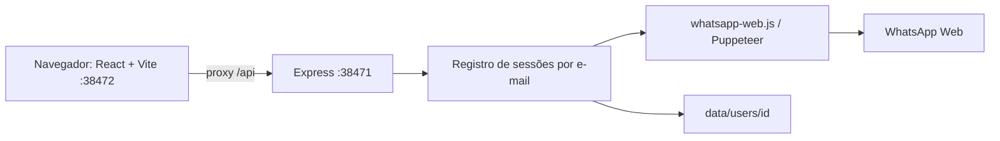
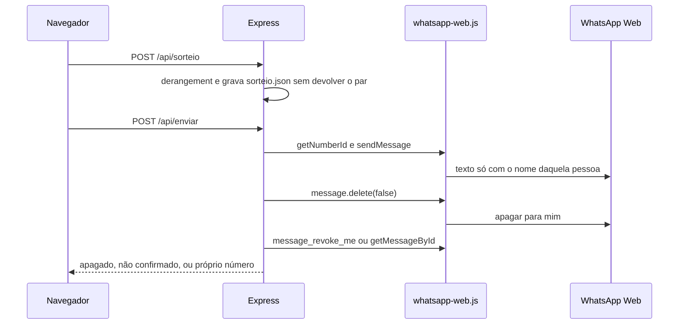

# secret-friend-on-whatsapp

Web app to run a Secret Santa (amigo secreto) over WhatsApp: connects a number by QR, draws pairs with no self-matches, sends each person their match and deletes it for the sender, keeping the draw secret even from the organizer.

Aplicativo web de amigo secreto pelo WhatsApp: conecta um número pelo QR, sorteia pares sem ninguém tirar a si mesmo, manda para cada pessoa só o nome que ela tirou e apaga essa mensagem para quem enviou, para o sorteio continuar secreto até para quem organiza.

A marca na tela é **Papelzinho**. No WhatsApp, em Aparelhos conectados, o aparelho aparece como **Papelzinho - ZAP** (Chrome).

## Visão geral e funcionalidades

O organizador entra com um e-mail, pareia um WhatsApp, cadastra a turma, sorteia e dispara o envio. A tela de andamento mostra se a mensagem saiu e se foi apagada para quem enviou. Ela não mostra quem tirou quem.

- **Login por e-mail, sem validação.** Não há senha nem confirmação de caixa de entrada. O e-mail é aparado, posto em minúsculas e aceito se tiver o formato `algo@algo` (3 a 200 caracteres). Ele só separa os dados neste navegador. O cookie `secret-friend-on-whatsapp-email` é `HttpOnly` e `SameSite=Lax`.
- **Conexão por QR.** O botão **Gerar QR** chama `POST /api/whatsapp/connect`. O `GET /api/whatsapp` (o polling da tela) só lê o estado: não abre o Chrome. Se uma abertura já está em andamento, outro clique espera a mesma tentativa.
- **Selo Verificado.** Fica verde quando o cliente está `ready` e `getChats()` terminou. Enviar e **Testar apagar** ficam bloqueados até esse selo.
- **Cadastro.** Nome e celular brasileiro com DDD, gravados no perfil daquele e-mail. O formulário só libera com o WhatsApp conectado. Até 200 pessoas.
- **Importação.** CSV (vírgula ou ponto e vírgula, UTF-8 com ou sem BOM), Excel `.xlsx` (dá para escolher a aba) ou um trecho colado da planilha. A prévia deixa escolher qual coluna é o nome e qual é o telefone. O app sugere pelo cabeçalho (`nome`, `telefone`, `celular`, `whatsapp`, `phone` e afins). Dá para marcar se a primeira linha é cabeçalho, substituir a lista ou acrescentar. Telefone inválido, vazio ou repetido aparece na prévia e não entra.
- **Mensagem.** O padrão é `Oi! No amigo secreto você tirou: {{sorteado}}. Guarda segredo 🤫`. `{{amigo}}` também vira o nome sorteado. Sem uma das duas marcas, o envio nem começa.
- **Sorteio.** Com pelo menos 2 pessoas, ninguém tira a si mesmo e cada pessoa é sorteada uma vez (permutação sem ponto fixo; se o sorteio aleatório não achar uma, cai numa rotação). Com uma pessoa só, não há sorteio. Sortear de novo substitui o resultado e fecha a quebra de sigilo.
- **Envio e apagar para mim.** Cada mensagem sai com `sendMessage`. Depois da pausa, `message.delete(false)` pede ao WhatsApp Web para apagar **para mim**, não para todos. Quem recebeu continua com o texto. Há até 3 tentativas. **Apagado** só entra se chegar `message_revoke_me` ou se a mensagem sumir ao recarregar. Sem isso fica **Enviado (não confirmado apagado)**.
- **O próprio número não é apagado.** Se o participante é o WhatsApp conectado, a mensagem é enviada e permanece. O detalhe fica “Enviado para o próprio número, não apagado.”
- **Testar apagar.** Manda `Teste Papelzinho #` e um código de 8 dígitos. O histórico guarda o destino mascarado (só os 4 últimos dígitos) e se o envio e o apagar confirmaram.
- **Quebra de Sigilo.** Abre um modal de proteção. A frase fixa é `quero quebrar o sigilo`. Ela precisa ser digitada: colar, arrastar, o menu do botão direito e `Ctrl/Cmd+V` estão bloqueados. Maiúsculas e espaços a mais não importam. Frase errada mantém a lista fechada. Depois de 5 erros seguidos, o modal espera 20 segundos. Só então a API devolve quem tirou quem (nome e telefone), com exportação JSON e CSV. A frase não é uma senha.

## Requisitos

- Node.js 20 ou mais recente
- Chrome ou Edge já instalados (no Linux também servem `google-chrome` ou `chromium`, se estiverem no caminho padrão)
- Windows ou Linux para o uso previsto. O código também procura Chrome e Edge no macOS, mas o fluxo testado no dia a dia é Windows e Linux
- Um celular com WhatsApp para ler o QR

## Como rodar

```bash
npm install
cp .env.example .env
npm run dev
```

No Windows, se não houver `cp`:

```bat
copy .env.example .env
npm install
npm run dev
```

Abra [http://127.0.0.1:38472](http://127.0.0.1:38472). A API fica em [http://127.0.0.1:38471](http://127.0.0.1:38471). O Vite encaminha `/api` para ela. Sem o arquivo `.env`, os padrões abaixo já valem.

`npm test` roda o Vitest. `npm run typecheck` checa a interface e o servidor. `npm run build` gera a interface em `dist/`. `npm start` sobe só a API (`tsx server/src/index.ts`), na porta `PORT`. Ele não serve a pasta `dist/`.

### Variáveis do `.env.example`

| Variável | Padrão | O que faz |
| --- | --- | --- |
| `DATA_DIR` | `data` | Pasta das sessões, listas, sorteios e testes. Caminho relativo é resolvido a partir da raiz do projeto. |
| `PORT` | `38471` | Porta da API. Inteiro de 1 a 65535. |
| `CLIENT_PORT` | `38472` | Porta do Vite em `npm run dev`. A API só usa esse valor no log, para dizer onde abrir a interface. |
| `CHROME_PATH` | vazio | Executável do Chrome ou do Edge. Se o arquivo existir, é ele que o Puppeteer abre. Se estiver vazio ou o arquivo não existir, o app procura os caminhos padrão do sistema. |
| `PUPPETEER_CACHE_DIR` | comentada | Não é lida pelo código deste app. É variável do Puppeteer: defina no terminal **antes** do `npm install` se for deixar o Puppeteer baixar um Chromium e o disco padrão estiver cheio. |
| `SEND_DELAY_MS` | `3000` | Pausa padrão entre uma pessoa e outra, em milissegundos. O servidor limita o valor entre 2000 e 15000. O perfil da tela só grava 2000, 3000, 4000, 6000 ou 8000. |
| `DELETE_FOR_ME_DELAY_MS` | `1500` | Espera depois do envio, antes de `message.delete(false)`. Limitada entre 500 e 10000. |
| `ACK_TIMEOUT_MS` | `6000` | Lida e limitada entre 1000 e 30000 em `config.ts`. O envio atual não consulta esse tempo. |
| `DELETE_CONFIRM_TIMEOUT_MS` | `8000` | Lida e limitada entre 1000 e 30000 em `config.ts`. A confirmação do apagar não usa esse tempo: espera 600 ms, olha `message_revoke_me` ou `getMessageById`, e tenta até 3 vezes. |
| `LOG_LEVEL` | `warn` | Nível do Pino: `silent`, `warn`, `info` ou `debug`. `info` mostra jid, id da mensagem e o passo do teste de apagar. O texto da mensagem e o nome sorteado não entram no log. |

## Estrutura de pastas

```text
secret-friend-on-whatsapp/
├── package.json              nome do pacote, scripts dev/test/build/start
├── package-lock.json
├── .env.example              variáveis documentadas acima
├── .gitignore                ignora node_modules, dist, .env e data/
├── index.html                título da aba: Papelzinho
├── vite.config.ts            porta da interface, proxy /api, watch sem data/
├── vitest.config.ts
├── tsconfig.json             interface
├── tsconfig.server.json      API
├── src/                      React
│   ├── main.tsx
│   ├── App.tsx               telas, polling, login
│   ├── api.ts                chamadas /api
│   ├── storage.ts            rascunho local do navegador
│   ├── index.css
│   └── components/           QR, cadastro, importação, mensagem, sigilo, envio
├── server/src/               Express
│   ├── index.ts              rotas e sinais de saída
│   ├── config.ts             .env e limites
│   ├── registry.ts           uma sessão por e-mail
│   ├── whatsapp.ts           whatsapp-web.js, QR, envio, delete(false)
│   ├── sender.ts             fila do envio
│   ├── browser-lock.ts       Chrome órfão e locks do perfil
│   ├── chrome-path.ts        CHROME_PATH e caminhos padrão
│   ├── profile.ts            perfil.json
│   ├── draw-store.ts         sorteio.json
│   ├── test-log.ts           testes.json
│   └── wa-flow.ts            confirmação do apagar
├── shared/                   regras usadas pela tela e pela API
│   ├── email.ts
│   ├── phone.ts
│   ├── template.ts
│   ├── derangement.ts
│   ├── sigilo.ts
│   ├── import-table.ts
│   ├── sheet.ts
│   ├── identity.ts           “é o próprio número?”
│   └── sync-gate.ts          código de 8 dígitos e selo Verificado
└── data/                     criada ao usar; não vai no git
    └── users/<32 hex>/
        ├── perfil.json
        ├── sorteio.json
        ├── testes.json
        └── wwebjs/session-<id>/   perfil do Chrome
```

Os testes Vitest ficam ao lado do código (`*.test.ts` e `src/components/PhraseField.test.tsx`).

## Arquitetura



Cada e-mail vira um id de 32 caracteres (SHA-256, só o começo do hash). O registro guarda em memória o perfil, o sorteio, o client do WhatsApp e a fila de envio daquele id. **Sair** fecha o Chrome daquela sessão e mantém os arquivos. Reiniciar a API também chama `client.destroy()` em `SIGINT`, `SIGTERM` e `beforeExit`.



Se o telefone é o da conta conectada, o diagrama para antes do `delete(false)`: a mensagem fica no chat.

## Rotas da API

Todas, menos `/api/health` e `/api/sessao`, exigem o cookie de e-mail. Respostas de `/api` levam `Cache-Control: no-store`. Corpo JSON, limite de 1 MB.

| Método | Rota | O que faz |
| --- | --- | --- |
| `GET` | `/api/health` | `{ ok: true }` |
| `GET` | `/api/sessao` | E-mail do cookie, ou `null` |
| `POST` | `/api/sessao` | Body `{ email }`. Abre a pasta do usuário e grava o cookie |
| `DELETE` | `/api/sessao` | Apaga o cookie e fecha o Chrome daquela sessão |
| `GET` | `/api/perfil` | Lista, mensagem e intervalo |
| `PUT` | `/api/perfil` | Grava lista, mensagem e intervalo |
| `GET` | `/api/whatsapp` | Estado da conexão, QR se houver, selo e histórico de testes. Não inicia o client |
| `POST` | `/api/whatsapp/connect` | Abre o WhatsApp (ou entra na abertura que já está em curso) |
| `POST` | `/api/whatsapp/logout` | Despareia. Recusa se houver envio em andamento |
| `POST` | `/api/whatsapp/testar-apagar` | Body opcional `{ telefone }`. Exige conectado e Verificado |
| `GET` | `/api/sorteio` | Sorteio público (status de envio, sem quem tirou quem) e andamento |
| `POST` | `/api/sorteio` | Body `{ participantes }`. Exige WhatsApp conectado. Devolve o sorteio sem os pares |
| `POST` | `/api/sigilo` | Body `{ frase }`. 403 se a frase não confere, 429 se estourou as tentativas, 200 com os pares |
| `POST` | `/api/enviar` | Body `{ mensagem, intervaloMs }`. 202 e a fila começa. Exige conectado, Verificado e um sorteio |

Qualquer outro caminho em `/api` responde 404 `{ error: "Não encontrado." }`.

## Armazenamento e segurança

`data/` é a senha do sorteio. Quem copia essa pasta leva a sessão do WhatsApp, a lista e o mapa de quem tirou quem. Não commite, não sincronize em pasta compartilhada e não mande para outra pessoa. O `.gitignore` já deixa `data/` e `.env` de fora.

Dentro de `DATA_DIR/users/<id>/`:

| Arquivo | Conteúdo |
| --- | --- |
| `perfil.json` | E-mail, nomes, telefones, texto do modelo e intervalo |
| `sorteio.json` | Pares completos, em texto, até o próximo sorteio |
| `testes.json` | Últimos 8 testes de apagar, destino mascarado |
| `wwebjs/session-<id>/` | Perfil do Chrome da sessão pareada |

O log não grava o texto enviado nem o nome sorteado. Em `info` entram jid, id da mensagem, caminho do executável escolhido e o código do teste de apagar. A tela pública também não recebe o par: isso só sai em `POST /api/sigilo`, depois da frase.

O apagar nunca roda quando o número do participante é o da própria instância.

## Debug e solução de problemas

- **`LOG_LEVEL=info`** ou `debug` no `.env`, e reinicie `npm run dev`, para ver jid e id da mensagem. `warn` é o padrão.
- **Navegador órfão.** Se o `tsx watch` ou o `concurrently -k` morrer no meio, o Chrome pode continuar segurando `data/users/<id>/wwebjs/session-<id>`. A próxima abertura, se receber “The browser is already running for …”, mata só processos do Chrome/Edge cuja linha de comando contém aquele perfil **e** que não são filhos deste processo. Em seguida apaga `SingletonLock`, `SingletonSocket`, `SingletonCookie` e `lockfile`, se nenhum Chrome nosso ainda estiver nesse perfil, e tenta uma vez de novo. A tela mostra o erro real, sem o caminho do usuário.
- **`CHROME_PATH`.** Se o Chrome não abre, aponte o `.exe` ou o binário. No Windows os caminhos padrão de Chrome e Edge já são procurados. O log `navegador escolhido` mostra o `executablePath`.
- **`PUPPETEER_CACHE_DIR`.** Use só se o Puppeteer for baixar o Chromium e o disco padrão estiver cheio. Defina antes do `npm install`. Com Chrome ou Edge instalados, o app não precisa desse download.
- **Vite e `EBUSY`.** O watch do Vite ignora `data/`, `.wwebjs_auth` e `.wwebjs_cache`. O `npm run dev:api` usa `tsx watch --exclude` nos mesmos caminhos. Um `DATA_DIR` relativo diferente de `data` também entra na lista do Vite, desde que não seja um caminho de outro disco.

## Deploy

Monte um volume persistente em `data/` (ou no caminho de `DATA_DIR`). Sem isso, cada deploy perde o pareamento e o sorteio.

Cada sessão conectada sobe um Chrome headless. Conte cerca de **300 a 500 MB de RAM por sessão** aberta. Várias pessoas ao mesmo tempo são vários Chromes.

Hoje a autenticação é local (`LocalAuth` na pasta `wwebjs`). **RemoteAuth com Postgres não está implementado**; seria um caminho futuro para não guardar o perfil do Chrome no disco da aplicação.

`npm start` sobe a API. A interface de `npm run build` precisa de um servidor estático na frente, com `/api` apontando para `PORT`. O `npm run dev` já faz essa ponte.

## Limitações e aviso

Isto não é a API oficial da Meta. É o WhatsApp Web por baixo, com `whatsapp-web.js` e Puppeteer. Uso abusivo pode fazer o WhatsApp **banir o número**. Faça o teste com um chip secundário.

“Apagar para mim” depende do comando do WhatsApp Web (`message.delete(false)`). Se o WhatsApp mudar a página, a confirmação pode falhar e o status fica “não confirmado apagado”. A mensagem no celular de quem recebeu não é apagada de propósito.

O mapa do sorteio fica em texto em `sorteio.json`. A frase da quebra de sigilo só evita um clique sem querer: quem tem a pasta `data/` lê os pares sem o modal.

## Créditos

Bibliotecas declaradas no `package.json`. A licença é a do pacote instalado em `node_modules` (campo `license` e, quando existe, o arquivo `LICENSE`). WhatsApp é marca da Meta. Este projeto não é afiliado à Meta nem ao WhatsApp.

### Em execução

- [whatsapp-web.js](https://github.com/wwebjs/whatsapp-web.js) — cliente do WhatsApp Web: QR, envio e `message.delete(false)`. O Chrome entra por uma dependência dessa biblioteca, não por um pacote separado neste `package.json`. Licença Apache-2.0.
- [Express](https://github.com/expressjs/express) — API HTTP. Licença MIT.
- [cors](https://github.com/expressjs/cors) — libera o navegador da interface a chamar a API. Licença MIT.
- [dotenv](https://github.com/motdotla/dotenv) — lê o `.env` na subida do servidor. Licença BSD-2-Clause.
- [pino](https://github.com/pinojs/pino) — log da API. Licença MIT.
- [qrcode](https://github.com/soldair/node-qrcode) — desenha o QR em imagem. Licença MIT.
- [React](https://github.com/react/react) — interface. Licença MIT.
- [react-dom](https://github.com/react/react) — coloca a interface na página. Licença MIT.
- [@radix-ui/react-dialog](https://github.com/radix-ui/primitives) — modal de importação e da quebra de sigilo. Licença MIT.
- [@radix-ui/react-slot](https://github.com/radix-ui/primitives) — o botão pode se comportar como outro elemento. Licença MIT.
- [class-variance-authority](https://github.com/joe-bell/cva) — variantes do botão. Licença Apache-2.0.
- [clsx](https://github.com/lukeed/clsx) — junta classes CSS. Licença MIT.
- [tailwind-merge](https://github.com/dcastil/tailwind-merge) — resolve classes Tailwind que se contradizem. Licença MIT.
- [lucide-react](https://github.com/lucide-icons/lucide) — ícones da tela. Licença ISC. O arquivo `LICENSE` do pacote nota que trechos vieram do Feather, sob MIT.
- [@fontsource/fraunces](https://fontsource.org/fonts/fraunces) — fonte dos títulos. Licença OFL-1.1.
- [@fontsource/outfit](https://fontsource.org/fonts/outfit) — fonte do texto. Licença OFL-1.1.
- [SheetJS (`xlsx`)](https://github.com/SheetJS/sheetjs) — lê a planilha `.xlsx` na importação. Licença Apache-2.0.

### Ferramentas de desenvolvimento

- [Vite](https://github.com/vitejs/vite) — servidor da interface e build de `dist/`. Licença MIT.
- [@vitejs/plugin-react](https://github.com/vitejs/vite-plugin-react) — transforma o React no Vite. Licença MIT.
- [tsx](https://github.com/privatenumber/tsx) — roda a API em TypeScript, com `watch` no desenvolvimento. Licença MIT.
- [TypeScript](https://github.com/microsoft/TypeScript) — checagem de tipos. Licença Apache-2.0 (`LICENSE.txt` do pacote).
- [Vitest](https://github.com/vitest-dev/vitest) — testes. Licença MIT.
- [happy-dom](https://github.com/capricorn86/happy-dom) — DOM dos testes de componente. Licença MIT.
- [@testing-library/react](https://github.com/testing-library/react-testing-library) — testa a tela como quem usa. Licença MIT.
- [@testing-library/user-event](https://github.com/testing-library/user-event) — simula teclado nos testes. Licença MIT.
- [@testing-library/dom](https://github.com/testing-library/dom-testing-library) — base da Testing Library. Está em `dependencies`, mas só entra nos testes. Licença MIT.
- [Tailwind CSS](https://github.com/tailwindlabs/tailwindcss) — estilos. Licença MIT.
- [@tailwindcss/vite](https://github.com/tailwindlabs/tailwindcss) — plugin do Tailwind no Vite. Licença MIT.
- [concurrently](https://github.com/open-cli-tools/concurrently) — sobe API e interface juntas no `npm run dev`. Licença MIT.
- [@types/node](https://github.com/DefinitelyTyped/DefinitelyTyped/tree/master/types/node) — tipos do Node.js. Licença MIT.
- [@types/express](https://github.com/DefinitelyTyped/DefinitelyTyped/tree/master/types/express) — tipos do Express. Licença MIT.
- [@types/cors](https://github.com/DefinitelyTyped/DefinitelyTyped/tree/master/types/cors) — tipos do cors. Licença MIT.
- [@types/react](https://github.com/DefinitelyTyped/DefinitelyTyped/tree/master/types/react) — tipos do React. Licença MIT.
- [@types/react-dom](https://github.com/DefinitelyTyped/DefinitelyTyped/tree/master/types/react-dom) — tipos do react-dom. Licença MIT.
- [@types/qrcode](https://github.com/DefinitelyTyped/DefinitelyTyped/tree/master/types/qrcode) — tipos do qrcode. Licença MIT.
